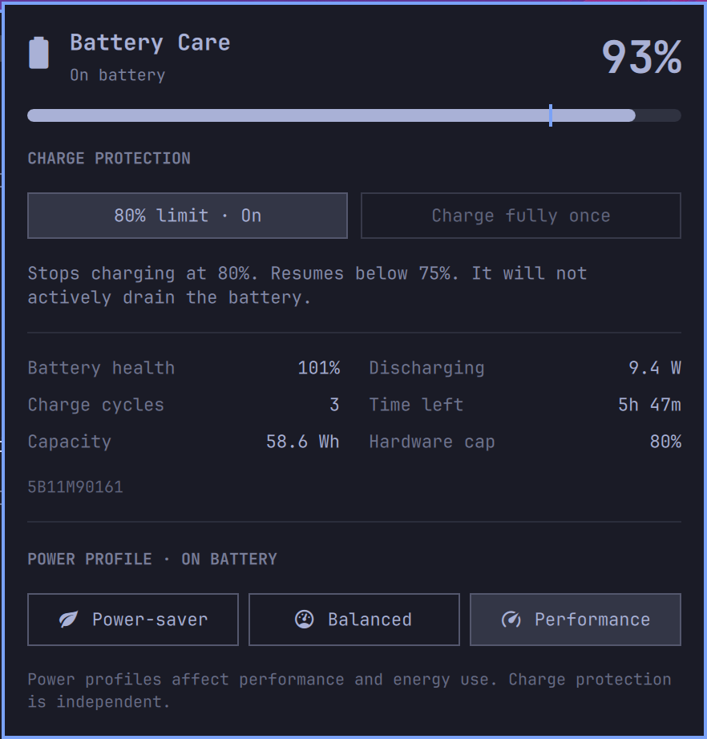

# Battery Care for Omarchy

A replacement for Omarchy’s Power widget: charge protection, a temporary full-charge session, and accurate battery information in one panel.

## Features

- **Protection toggle:** click the limit button to turn it **On** or **Off**. Off allows charging to 100% until you enable protection again; the recovery guard respects this choice across unplugging and reboot. On enables the preset supplied by UPower. On the tested ThinkPad X1 Gen 14 this is **start below 75%, stop at 80%**. Other machines show their actual preset rather than a hard-coded 80% label.
- **Charge fully once:** lifts the limit for the current plugged-in session. Protection returns after unplugging, or at the next user login after a reboot. While active, the button becomes **Cancel full charge**, which restores protection immediately, even if you have just unplugged. The protection toggle can also restore the limit.
- **Accurate status:** an available preset is never presented as enabled. Hardware limits are displayed separately; disagreements with UPower are flagged.
- **Useful telemetry:** health, cycle count, full capacity, charge/discharge power, runtime, and battery model. The charge bar marks the real active cap.
- **Using significant energy:** like the macOS battery menu, lists the apps and services with the highest recent CPU and GPU activity, grouped by the systemd scope each app runs in (browser helpers count toward the browser). After 5 minutes on battery, each entry also shows an estimated wattage. Unprivileged, nothing is stored; see [Energy use](#energy-use).
- **Battery history:** like macOS Settings → Battery, the last 24 hours (battery level and power use per 15 minutes, plugged-in periods highlighted) or 10 days (battery energy per day), with the apps that used the most energy on battery. Stored only on this device; recording can be switched off and the history cleared.
- **Charger warnings:** if a connected charger cannot keep up (too weak, loose cable, wrong port), the panel says **Plugged in · battery draining** and a desktop notification appears, even with the panel closed.
- **Power profiles:** retains Omarchy’s separately remembered plugged-in and battery profiles.
- **Screen & lock:** shared or separate battery/plugged-in screensaver and lock timeouts, presets and custom minutes/seconds, Apply/Cancel, and a Stay Awake indicator. Existing settings are inherited until you apply a change.
- **Multiple batteries:** independently selectable controls and recovery state; peripheral batteries are excluded. Unsupported batteries retain monitoring.
- **Keyboard:** arrows select available charge actions and profiles (disabled actions are skipped), Enter activates, Escape closes, `[` / `]` selects batteries, and `D` dismisses an action error. Right-click the tray icon toggles its percentage.
- **Screen settings keyboard:** `S` opens Screen & lock and `U` opens Battery history. Tab moves between its controls; Enter opens a selector, arrows choose a value, and Escape closes a menu or cancels the form. Unsaved drafts survive background refreshes and are discarded when the panel closes.
- **Failure visibility:** stale status disables charge actions, action errors persist until dismissed or retried, and an inactive recovery guard is reported. Small panels scroll, and narrow panels stack their controls.



## Requirements

Omarchy 4.x with its Quickshell plugin system, UPower with `EnableChargeThreshold` support for charge controls, `/usr/bin/python3`, `python-gobject`, and a systemd user session. Monitoring does not require threshold support. UPower/Polkit authorizes changes as the active desktop user; the plugin does not install privileged helpers or custom Polkit rules.

## Install

```sh
omarchy plugin add https://github.com/Dandiccf/omarchy-plugin-battery-care --enable
```

If the Python GObject dependency is missing, install it with `omarchy pkg add python-gobject`.
Enabling Battery Care replaces the standard Power widget. Charge settings change only when you choose a charge action.

## Local development install

```sh
./install-local.sh
```

The installer validates the plugin, backs up `~/.config/omarchy/shell.json`, and links this folder to `~/.config/omarchy/plugins/dandiccf.battery-care`. Enabling it replaces `omarchy.power` using Omarchy’s supported `clonedFrom` mechanism, preserving the stock IPC target and widget placement. Source stays in your development checkout. Installing alone does not change charging settings.

The installer's configuration backup has a unique random filename and private permissions. It verifies the source file and directory, refuses unsafe paths, and never replaces an existing backup or follows a backup symlink. Backup failure stops installation before enabling the widget.

Choose **80% limit** (or the device’s offered protection preset) to enable protection. The first protection or temporary full-charge action installs and enables a small user timer. Turning protection Off does not require installing a timer. Development edits usually reload automatically; if Quickshell retains cached QML or JavaScript, run `omarchy restart shell` while the desktop is unlocked. A plugin rescan alone may not reload imported JavaScript.

Update a git-installed copy with:

```sh
omarchy plugin update dandiccf.battery-care
```

## Recovery behavior

The first protection or temporary full-charge action creates:

- `~/.config/systemd/user/omarchy-battery-care.service`
- `~/.config/systemd/user/omarchy-battery-care.timer`
- `~/.local/state/omarchy-battery-care/state.json`

Unplugging restores protection immediately: the panel reacts to UPower’s unplug event, even if the charger is reconnected a moment later. The timer checks every 15 seconds as a fallback and works even if the panel is closed, the widget is disabled, or the shell restarts. A durable recovery record is written **before** disabling the cap. Unplugging or a changed kernel boot ID converts a temporary full session back to protection. Failed restoration retains the record and retries; the panel displays the failure. Devices are matched using a hash of native path, model, and serial, avoiding accidental changes to a replacement battery.

State is stored in a private, user-owned directory. Managed paths must be real directories (including the ancestors of `XDG_STATE_HOME` and `XDG_CONFIG_HOME`); symlinked paths and unsafe shared-writable directories are rejected. Lock, state, and unit files must be user-owned regular files without extra hard links or group/world write access. Existing recovery units are reused only when their complete contents match this installation, including its helper path. Foreign or modified files are never overwritten or automatically removed; resolve any reported conflict before retrying. Exact units from 0.2.0 at the same installation path remain compatible.

This is a **user-session** guard. After reboot, restoration happens at login, not during firmware startup or while the machine is powered off. With the widget disabled or the shell not running, only the timer applies, and very brief unplug/replug events between its checks may not be observed; in that case unplug for at least one check interval or click the protection button. User-session authorization must be available for UPower to apply changes. Disabling the widget deliberately does not disable the guard or abandon a pending recovery.

Once protection is selected, the guard keeps it enabled until you switch the limit Off. Turning it Off also cancels any pending temporary full-charge recovery. If another charge manager repeatedly changes the settings, choose one owner for charge protection. Preset values are supplied by UPower; this version does not write arbitrary sysfs thresholds.

## Reading the panel

- A plug icon means external power is connected; the charging icon appears only while charging. “Plugged in · charge paused” makes a connected charger visible while protection holds the battery between its start and stop thresholds.
- At a current charge above the limit, protection stops further charging; it does not force battery discharge.
- “Health” is reported full capacity divided by design capacity. A new battery may show slightly above 100%; this is normal measurement/manufacturing variation, not a charging percentage.
- **Laptop power** on battery is the measured discharge, the whole laptop's consumption. **Into battery** (plugged in) is only the power going into the battery.
- **From charger** and **Laptop power** on AC power are estimates (“≈”). Charger input and total consumption are not readable without root. While on battery, Battery Care learns how laptop power follows CPU and GPU activity. On AC power, it predicts laptop power from current activity and adds the battery's net power, plus about 8% conversion loss. Both show “—” until about 10 minutes of battery use have been learned. The small model (five numbers) is stored privately in `~/.local/state/omarchy-battery-care/power-model.json` and can be deleted at any time.
- If firmware reports 0 W, net battery power is measured from changes in stored energy over at least 30 seconds and shown with “≈”. Plugged in but losing more than 1 W shows **Plugged in · battery draining** and a warning: the charger, cable, or port is not delivering enough power.
- Runtime and power flow come from UPower and are estimates. With a charge limit active, **Time to 80%** (or your limit) is computed from the current charging rate; charging slows near the limit, so treat it as a lower bound.
- Power profile selection is independent of battery charge protection.

## Energy use

**Using significant energy** shows up to five apps or services whose CPU and GPU time over the last 3 minutes reaches an impact of at least 5. An impact of 100 means one CPU core or GPU engine is fully busy. `energy.py` reads per-unit `cpu.stat` counters from the systemd cgroup tree and DRM `fdinfo` GPU counters for your own processes. Names come from desktop entries. Launcher scopes such as `gtk-launch` are named after the program they run, and web apps after their desktop entry or host. Samples are kept in memory only: every 5 seconds while the panel is open and every 30 seconds while it is closed.

Linux does not expose per-app power without root, so watts are estimates. After 5 minutes of uninterrupted battery readings, the drain above the lowest recent rate (an approximation of the display and idle baseline) is split by activity share. On AC power, or before the baseline is known, only impact is shown. GPU time is available on drivers that publish DRM fdinfo usage (`xe`, `i915`, `amdgpu`); other system users' GPU clients are not visible.

## Battery history

Open **Battery history** at the bottom of the panel, or press `U`. **24 hours** shows the battery level and the average power use on battery for each 15-minute step. Plugged-in steps are highlighted. **10 days** shows the battery energy used per day. Both views list the apps and services with the largest share of CPU and GPU time while on battery.

The panel aggregates its existing samples in memory and stores one record per 15 minutes in `~/.local/state/omarchy-battery-care/history.json`, a private file, for 10 days. Each record contains the time, battery level, time on battery and plugged in, battery energy used, and up to five app names with their activity. Gaps mean the laptop was asleep or off, or the shell was not running; nothing is filled in. Switch **Record battery history** off to stop recording, or choose **Clear history** to delete the file. The widget setting `historyEnabled` controls the same switch.

## Screen & lock

Open **Screen & lock** below Power profile, or press `S` with the panel open. It opens a compact settings view in the same popup; **Back**, **Cancel**, or Escape returns to the battery overview and discards unsaved edits. The popup is capped at 620 logical pixels and the available screen height, with scrolling when needed; narrow layouts stack the two power sources. Initially, both power sources inherit your existing Omarchy timeouts. Enable **Separate power-source settings** to edit battery and plugged-in values independently. The current source is highlighted. Disabling the toggle copies that source's draft values into the shared pair; previously saved separate values remain available when re-enabled.

Choose a preset or **Custom…** and enter minutes and seconds (1 second to 24 hours). Existing zero-valued settings are retained and shown as **Immediately**. Both timeouts count from the last activity: screensaver at 2 minutes and lock at 5 minutes means five minutes total, not seven. There is no Never option: Omarchy treats zero as immediate, not disabled. **Apply** saves; **Cancel** discards the draft. **Reload** discards the draft and reads the latest saved settings. Stay Awake is displayed and respected; Battery Care never changes its setting.

Omarchy's existing idle service still starts the screensaver and locks the session. Battery Care writes only the selected timeout pair and its preferences under `idle.batteryCare` in `~/.config/omarchy/shell.json`. It preserves other configuration, uses verified regular files and atomic writes, checks for concurrent changes, and makes a private `idle-shell-before-*.json` backup in its state directory before each explicit save. Invalid files and unsafe/symlinked paths are refused.

**Automatic switching waits while you are away.** Changing the stock idle service's timer intervals can restart a countdown, so Battery Care monitors power-source changes but only applies a different pair while activity is detected and Omarchy confirms no idle/lock cycle is in progress. A pending switch is shown in the panel; the old timeout pair remains in effect until you return. This preserves the existing lock deadline. Switching also works with the panel closed, while the widget is enabled. It does not require the charge-recovery timer or charge-threshold support.

If another tool edits Omarchy's timeouts, automatic switching stops and shows a conflict instead of replacing that edit. Reload the form, review its values, and Apply to resume management. Disabling/removing Battery Care stops automatic switching; Omarchy retains the last active pair and the inert saved preferences. The installed Omarchy idle service must be available for Apply.

## Revert / uninstall

Restore the standard widget:

```sh
omarchy plugin disable dandiccf.battery-care
omarchy plugin enable omarchy.power
```

For the local development install, restore the standard widget and remove its local link and recovery units with:

```sh
./uninstall-local.sh
```

For a git-managed install, first release management before using Omarchy’s plugin removal:

```sh
/usr/bin/python3 ~/.config/omarchy/plugins/dandiccf.battery-care/battery.py release
omarchy plugin remove dandiccf.battery-care
```

Release restores protection for managed protection/full-charge modes and preserves an explicit **Off** choice. It refuses to abandon an absent battery with a pending full-charge session or a failed restoration. It verifies ownership and exact contents of both recovery units before changing anything, then disables the timer, removes only those verified units, and reloads the user service manager. If release reports an error, resolve it before removing the plugin or source directory. The local uninstall script uses this same checked cleanup.

## Verification

```sh
omarchy plugin validate .
/usr/bin/python3 -m unittest discover -s tests -v
node tests/test-model.js
node tests/test-energy.js
./tests/run-qml.sh  # Requires the Wayland session; uses a simulated battery
/usr/bin/python3 battery.py status
```

Regression coverage includes the inactive 80% preset bug, reboot and unplug recovery, canceling a full session, failed authorization and retries, replacement batteries, unsupported devices, missing telemetry, and external-manager mismatches. Live status, applying the 75–80% preset, and automatic guard restoration after temporarily disabling protection were verified on a ThinkPad X1 Gen 14. The full-charge action was also verified with the charger connected: UPower disabled protection and the hardware cap changed from 80% to 100%, with the recovery guard retaining the temporary session. Physical unplug recovery also passed: after disconnecting the charger, the running guard restored enabled protection, the 80% hardware cap, and protection mode. A physical reboot/login with protection already enabled also passed: the timer restarted successfully, and UPower and the hardware retained the 75–80% limits. Reboot recovery from an active temporary full-charge session is covered by automated tests but still needs a physical test.

## Provenance

Based on the structure and styling of Omarchy’s Power widget, installed Omarchy version 4.0.4-1. Shared `qs.Ui` components keep it aligned with the desktop theme. MIT licensed; upstream attribution is in LICENSE.

The code and usability review, including the 0.2.1 marketplace file-safety fixes and 0.3.0 Screen & lock feature, is recorded in [REVIEW.md](REVIEW.md), with test boundaries and remaining limitations.

## Languages

On Omarchy 4.5+, Battery Care follows Setup → Language through the native `Commons.Translations` API, including live changes. On earlier Omarchy 4.x shells, it selects translations from the process environment (`LC_ALL`, then `LC_MESSAGES`, then `LANG`, with Qt’s locale as a final fallback). Restart the shell after changing the system locale. `C` and `POSIX` select English. The battery indicator supports both the older combined text and newer separate label APIs. English, German, Spanish, French, Portuguese, Italian, Polish, Russian, Arabic, Hindi, Japanese, Korean, and Simplified Chinese are included; other languages fall back to English. Spanish (Mexico) and Portuguese (Brazil) currently use the base Spanish and Portuguese catalogs. Technical diagnostics from UPower, system commands, and the filesystem are preserved when no translation is available.

To add a language, copy `i18n/en.json` to `i18n/<language-code>.json` and translate the values, keeping the English keys and `%1`/`%2` placeholders intact. Regional variants fall back to their base language first. Run `bash tests/run-qml.sh` to check the QML UI and live language switching.

Compatibility checks use the installed 4.5 shell and official 4.0.0 and 4.0.4 source fixtures with no native translation API. To test a downloaded older shell with current Qt, first run `python3 tests/prepare-legacy-fixture.py /path/to/old/shell /tmp/legacy-shell`; this qualifies upstream `Color` references in a disposable copy to avoid a newer-Qt namespace collision without changing the older component APIs. Then run `BATTERY_CARE_TEST_SHELL=/tmp/legacy-shell bash tests/run-qml.sh`. These are component-level checks on the current Qt/Quickshell runtime, not a full older desktop installation.
